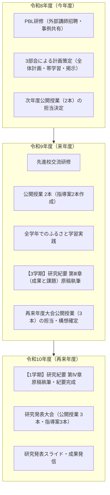

# ふるさと学習の推進体制と今後の研究計画について
今年度中の策定事項・公開授業（計5本）の担当決定・今後2年間のロードマップ

研究主題：「９年間のつながりの中で、主体的に学び、学びを深める児童生徒の育成 〜生活科から総合的な学習の時間へとつなぐ『ふるさと学習』の実銭を通して〜」

合意形成のために、必要な資料をポータルサイト（[index.html](file:///Users/t-cool/Desktop/総合/index.html)）としてまとめました。

---

## 1. 今年度中（令和8年度）に策定する重要計画

今年度中に以下の3つの計画・指導ツールを策定します。資料は [index.html](file:///Users/t-cool/Desktop/総合/index.html) の「R8年度中に検討する資料」に掲載されています。

### (1) ふるさと学習 全体計画（担当：天部会）
* 該当資料: [ふるさと学習 全体計画（案）](file:///Users/t-cool/Desktop/総合/plan/plan.html)
* 内容: 
  - 1・2年（生活科）から3〜9年（総合的な学習の時間）までの9年間を見通した探究カリキュラム
  - 4段階のルーブリック評価基準（知る・学ぶ／学ぶ・広める・深める／考える・深める・発信・提案する／探究の再確認・地域課題への参画と発信）
  - 学習指導要領改訂の趣旨（言語活動の充実、協同的な問題解決、体験活動の位置づけ等）を踏まえた改訂
* 関連資料: [振り返りの記録（意識変容アンケート）](file:///Users/t-cool/Desktop/総合/furikaeri/furikaeri.html)

### (2) 帯学習・ポスターセッション支援計画（担当：木部会）
* 該当資料: [帯学習（ポスターセッション支援資料）](file:///Users/t-cool/Desktop/総合/obi/obi.html)
* 内容: 
  - 日常的な対話力・表現力を育成する帯活動の位置づけ
  - 学年段階別「卓上お助けカード（話型支援：1〜2年、3〜4年、5〜6年、7〜9年）」の整備
  - 「振り返りシート」および教室提示用「10分タイマー」の運用方法
* 関連資料: [過去の探究テーマ集](file:///Users/t-cool/Desktop/総合/kako/kako.html)

### (3) ふるさと教材バンク・校内掲示計画（担当：川部会）
* 該当資料: [ふるさと教材バンク・校内掲示](file:///Users/t-cool/Desktop/総合/keiji/keiji.html)
* 内容: 
  - 児童生徒の成果物（ポスター・デジタル資料等）の蓄積・共有（実物展示・ストック保管・端末での閲覧）
  - 校内掲示スペース（オープンスペース、廊下壁面、教室前掲示板等）の活用計画
* 関連資料: [ふるさと人材バンク](file:///Users/t-cool/Desktop/総合/bank/jinzai.html)

> [!NOTE]
> 【参考：backup フォルダ】
> [backup/](file:///Users/t-cool/Desktop/総合/backup) フォルダ内に、学習指導要領改訂要点メモ（[kaitei-1-2nen.txt](file:///Users/t-cool/Desktop/総合/backup/plan/kaitei-1-2nen.txt)、[kaitei-3-9nen.txt](file:///Users/t-cool/Desktop/総合/backup/plan/kaitei-3-9nen.txt)）、新旧対照表（[backup/新旧対照/](file:///Users/t-cool/Desktop/総合/backup/新旧対照)）、過去の発表プログラム（[backup/previous/](file:///Users/t-cool/Desktop/総合/backup/previous)）などの一次資料を保管しています。

---

## 2. 来年度（R9）・再来年度（R10）の公開授業と指導案作成について

来年度から再来年度にかけて合計5本の全体授業を公開します。誰がどの授業を担当するかを決定する必要があります。

### (1) 公開授業および指導案作成スケジュール

| 年度 | 実施内容 | 公開本数 | 対象教科・領域 | 指導案作成 | 位置づけ |
| :--- | :--- | :---: | :--- | :---: | :--- |
| 令和9年度（R9） | 公開授業 | 2本 | 総合的な学習の時間 （または ふるさと学習に関連する単元の教科） | 2本 | 事前公開授業 |
| 令和10年度（R10） | 研究発表大会 | 3本 | 総合的な学習の時間 | 3本 | 本大会 公開授業 |
| 合計 | | 5本 | | 5本 | |

* 指導案管理ページ: [公開授業・指導案（一覧）](file:///Users/t-cool/Desktop/総合/shidouan/shidouan.html)

### (2) 決定事項
* 授業者・対象学年の選定:
  - 来年度（R9）の2本、再来年度（R10）の3本の計5本について、担当者および対象学年を決定する。
  - R9年度の2本は、総合的な学習の時間またはふるさと学習に関連する単元の教科授業。
  - R10年度の3本は、本大会における総合的な学習の時間の授業。
* 指導案（計5本）の作成および単元構想の準備を進めるため、早期の担当決定が必要。

---

## 3. 研究紀要（案）にみる今後2年間のロードマップ

[研究紀要（案）](file:///Users/t-cool/Desktop/総合/taisei/taisei.html)に記載されている今後2年間の研究計画・スケジュールは以下の通りです。

### 年次別計画
* 令和8年度（今年度）:
  - PBL（プロジェクト型学習）研修の実施（吉田正志教諭招聘等）
  - 全体計画・帯学習・掲示計画の策定
  - 今後2年間の授業公開担当者の決定
* 令和9年度（来年度）:
  - 先進校との交流研修
  - 各学年でのふるさと学習実践
  - 公開授業 2本（指導案2本作成）
  - 3学期：研究紀要 第Ⅲ章「校内研究の成果と課題」の原稿執筆
* 令和10年度（再来年度）:
  - 1学期：研究紀要 第Ⅳ章「研究の成果と今後の課題」の原稿執筆・紀要完成
  - 研究発表大会（公開授業 3本、指導案3本作成）
  - [研究発表スライド](file:///Users/t-cool/Desktop/総合/slide/present.html)等の成果発信

---

## 4. ポータルサイトの構成と利用

* ポータルサイト: [index.html](file:///Users/t-cool/Desktop/総合/index.html)
* オンラインURL: [https://t-cool.github.io/tenkawa/](https://t-cool.github.io/tenkawa/)
* 構成:
  - セクション1：R8年度中に検討する資料
    - 研究紀要（案）、全体計画、振り返りの記録、テーマ集、帯学習、教材バンク・校内掲示、人材バンク
  - セクション2：R9~10年に作成する資料
    - 指導案（計5本）、各学年の取組、研究発表スライド
* 機能:
  - [全体計画（plan.html）](file:///Users/t-cool/Desktop/総合/plan/plan.html)：A3 PDF保存対応
  - [帯学習（obi.html）](file:///Users/t-cool/Desktop/総合/obi/obi.html)：A4印刷対応（卓上カード・振り返りシート）
  - [研究紀要（taisei.html）](file:///Users/t-cool/Desktop/総合/taisei/taisei.html)：A4印刷対応

---

## 5. 今後の進め方

1. 各部会での計画策定（今年度内）
   - 天部会：全体計画の策定
   - 木部会：帯学習（ポスターセッション支援資料）の策定
   - 川部会：校内掲示・教材バンク計画の策定
2. 公開授業（計5本）の担当決定
   - R9（2本）、R10（3本）の授業担当者および対象学年を全体会で決定する。
3. 資料確認
   - ポータルサイト（[index.html](file:///Users/t-cool/Desktop/総合/index.html)）の該当資料を確認する。
